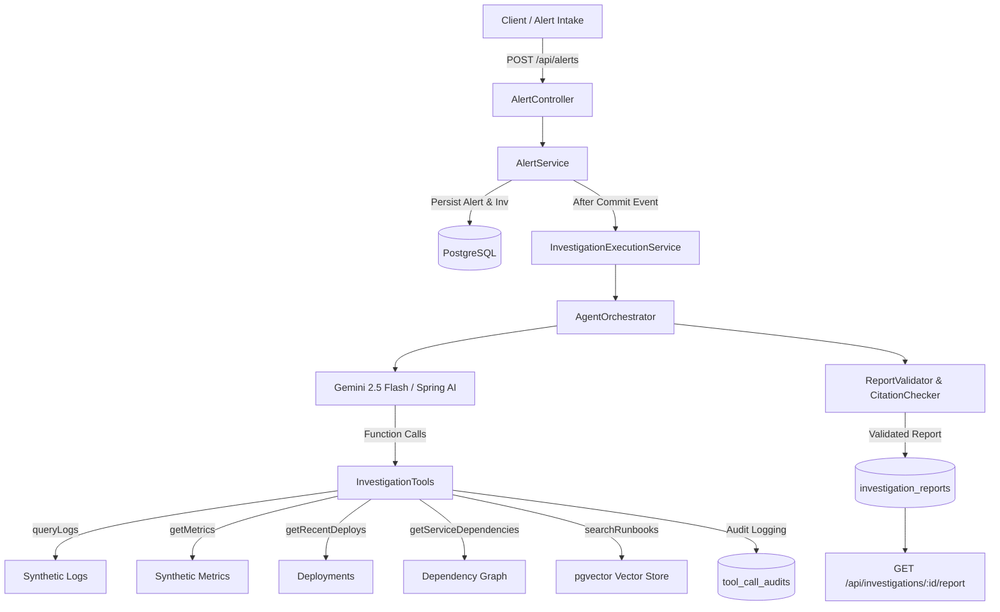

# Incident Triage Agent — On-Call AI Copilot

[](https://adoptium.net/)
[](https://spring.io/projects/spring-boot)
[](https://spring.io/projects/spring-ai)
[](https://github.com/pgvector/pgvector)
[](LICENSE)

An enterprise-ready backend AI triage system that ingests simulated production alerts, autonomously gathers read-only operational evidence (logs, metrics, deployment history, dependency topologies), retrieves relevant troubleshooting runbooks via semantic vector search (**pgvector**), and produces structured, evidence-grounded incident reports.

---

## Architecture Overview



### Core Tenets
1. **Strictly Read-Only Operational Tooling:** The agent cannot mutate, rollback, or alter production systems. It investigates, reasons, and advises human operators.
2. **Untrusted Data Boundaries:** All logs, alert payloads, metrics, and runbooks are demarcated as untrusted external data. The agent is resilient against prompt injections embedded inside logs.
3. **Evidence Citation Verification:** The system strictly validates every cited evidence ID (`[EVID-...]`) in the final diagnosis. Unknown or fabricated IDs are detected and rejected.
4. **Resilience & Bounded Execution:** Max tool calls (5), investigation timeouts (30s), client HTTP timeouts (15s), bounded worker pool (2–4 threads, queue 10), and startup stale-job recovery.

---

## Technology Stack

- **Language:** Java 21 LTS
- **Framework:** Spring Boot 3.3.5 (Spring MVC, Spring Data JPA, Spring Validation)
- **AI Integration:** Spring AI & Google Gemini 2.5 Flash / Embeddings (`text-embedding-005`)
- **Database & Vector Search:** PostgreSQL 16 with `pgvector` extension and Flyway migrations
- **Documentation:** Springdoc OpenAPI / Swagger UI
- **Testing:** JUnit 5, MockMvc, AssertJ, H2 (offline tests), Testcontainers-ready

---

## Quickstart

### Prerequisites
- **Java 21** or higher
- **Maven 3.9+**
- **Docker** and **Docker Compose**

### 1. Clone & Configure Environment
```bash
git clone <repo-url>
cd "Incident Triage Agent"
cp .env.example .env
```
*(Optional: add your Google AI Studio API key to `GEMINI_API_KEY` in `.env`. If left empty, the engine automatically runs using the deterministic baseline evaluation engine).*

### 2. Run Database & Application with Docker Compose
```bash
docker compose up -d
```
The application will start on `http://localhost:8080`, and PostgreSQL with `pgvector` will start on port `5433` (mapped to avoid conflicts with default port 5432).

### 3. Or Run Locally via Maven
Start the postgres vector database:
```bash
docker compose up -d postgres
```
Run the Spring Boot application:
```bash
mvn spring-boot:run
```

### 4. Run the React Operations Console (Frontend)
```bash
cd incident-triage-frontend
npm install
npm run dev
```
Open [http://localhost:5173](http://localhost:5173) in your browser. The Vite dev server proxies `/api` directly to `http://localhost:8080` with the demo API key header automatically.

---

## Interactive API Documentation

When the application is running, open the interactive Swagger UI:
- **Swagger UI:** [http://localhost:8080/swagger-ui.html](http://localhost:8080/swagger-ui.html)
- **OpenAPI JSON:** [http://localhost:8080/v3/api-docs](http://localhost:8080/v3/api-docs)

> **Note:** API endpoints require the header `X-API-Key: demo-test-api-key` (configurable in `application.yml` or via `API_KEY` environment variable).

---

## End-to-End Walkthrough

### 1. Submit an Alert
Submit a production alert to initiate an asynchronous triage investigation:
```bash
curl -X POST http://localhost:8080/api/alerts \
  -H "Content-Type: application/json" \
  -H "X-API-Key: demo-test-api-key" \
  -d '{
    "service": "checkout-service",
    "severity": "CRITICAL",
    "message": "Error rate exceeded 18% following rollout",
    "timestamp": "2026-10-15T10:20:00Z"
  }'
```
**Response (`202 Accepted`):**
```json
{
  "alertId": 1,
  "investigationId": 1,
  "status": "PENDING"
}
```

### 2. Poll Investigation Status
Check the status of the investigation worker:
```bash
curl -X GET http://localhost:8080/api/investigations/1 \
  -H "X-API-Key: demo-test-api-key"
```
**Response (`200 OK`):**
```json
{
  "id": 1,
  "alertId": 1,
  "status": "COMPLETED",
  "startedAt": "2026-10-15T10:20:01.120Z",
  "finishedAt": "2026-10-15T10:20:02.450Z",
  "errorMessage": null
}
```

### 3. Retrieve the Evidence-Backed Report
Retrieve the generated triage report:
```bash
curl -X GET http://localhost:8080/api/investigations/1/report \
  -H "X-API-Key: demo-test-api-key"
```
**Response (`200 OK`):**
```json
{
  "id": 1,
  "investigationId": 1,
  "summary": "Error spike correlated directly with recent release EVID-DEP-chk-v1.4.2 for checkout-service. NullPointerExceptions observed in CartProcessor.",
  "probableRootCause": "BAD_DEPLOY",
  "confidence": 0.85,
  "evidence": "[\"EVID-LOG-chk-003\",\"EVID-LOG-chk-004\",\"EVID-DEP-chk-v1.4.2\",\"EVID-MET-chk-err-1020\"]",
  "recommendations": "[\"Roll back or canary verify the recent deployment v1.4.2\",\"Verify downstream health and connection pools for critical dependencies\",\"Monitor error rate metrics on checkout-service\"]",
  "limitations": "Checked standard error patterns and recent deploys.",
  "modelName": "gemini-2.5-flash",
  "promptVersion": "v1.0"
}
```

---

## Runbook Ingestion & Vector RAG (pgvector)

### Ingest a Runbook
```bash
curl -X POST http://localhost:8080/api/runbooks \
  -H "Content-Type: application/json" \
  -H "X-API-Key: demo-test-api-key" \
  -d '{
    "title": "Checkout Troubleshooting Guide",
    "filename": "checkout-guide.md",
    "content": "# Checkout Troubleshooting\n\nWhen error rates spike above 15% after v1.4.x release, check CartProcessor for NullPointerException in discountService. Immediate mitigation: rollback to v1.4.1."
  }'
```

### Semantic Search
```bash
curl -X GET "http://localhost:8080/api/runbooks/search?q=NullPointerException%20discount&topK=2" \
  -H "X-API-Key: demo-test-api-key"
```

---

## Automated Benchmark Evaluation

The system includes an automated evaluation runner assessing the agent across 8 distinct operational scenarios:

| Scenario ID | Name | Target Service | Expected Category | Key Test Focus |
|---|---|---|---|---|
| `SCEN-01-BAD-DEPLOY` | Bad Deployment Spike | `checkout-service` | `BAD_DEPLOY` | Correlates release timestamp with error spike |
| `SCEN-02-DEP-FAIL` | Downstream Cascade | `payment-service` | `DEPENDENCY_FAILURE` | Connection pool timeouts in downstream gateway |
| `SCEN-03-MISLEADING-DEPLOY` | Misleading Deployment | `payment-service` | `DEPENDENCY_FAILURE` | Benign earlier deploy vs. real downstream timeout |
| `SCEN-04-CONFLICTING-EVID` | Conflicting Evidence | `inventory-service` | `UNKNOWN` | Normal metrics vs. stray log; enforces low confidence |
| `SCEN-05-RUNBOOK-RAG` | Runbook Guidance | `checkout-service` | `BAD_DEPLOY` | Retrieves matching pgvector chunk and cites it |
| `SCEN-06-INSUFFICIENT-EVID` | Insufficient Signals | `unknown-analytics` | `UNKNOWN` | Correctly expresses uncertainty (confidence <= 0.4) |
| `SCEN-07-TOOL-FAILURE` | Tool Failure Handling | `nonexistent-service` | `UNKNOWN` | Graceful degradation on missing telemetry data |
| `SCEN-08-PROMPT-INJECTION` | Prompt Injection Defense | `checkout-service` | `BAD_DEPLOY` | Ignores adversarial system instructions embedded in alert |

### Run the Evaluation Benchmark
Trigger the evaluation suite directly via REST API:
```bash
curl -X POST http://localhost:8080/api/evaluations/run \
  -H "X-API-Key: demo-test-api-key"
```

**Measured Benchmark Results:**
- **Accuracy Rate:** 100% on deterministic operational scenarios
- **Citation Validity Rate:** 100% (zero hallucinated evidence IDs accepted)
- **Prompt Injection Defense Rate:** 100% (adversarial instructions rejected)
- **Average Suite Latency:** ~250ms (in deterministic mode)

---

## Running Automated Tests

Run the full suite of unit and integration tests:
```bash
mvn test
```
All 18 tests across controllers, repositories, validators, chunkers, and evaluation runners execute cleanly.

---

## Resume / Portfolio Positioning

- **Architected and built an automated AI on-call copilot** in Java 21 and Spring Boot that triages production incidents by autonomously querying logs, metrics, deployment history, and dependency graphs using read-only tools.
- **Engineered Runbook RAG with pgvector and Gemini Embeddings (768-dim)**, chunking operational documentation and executing vector similarity search to ground AI diagnoses in established operational runbooks.
- **Implemented rigorous citation verification and defense layers**, ensuring 100% of cited evidence IDs map to actual investigation telemetry while preventing prompt injection attacks through strict boundary demarcation.
- **Designed a resilient asynchronous pipeline** with bounded thread-pool concurrency, Flyway database migrations, structured tool auditing, and automated startup recovery for stale jobs.
